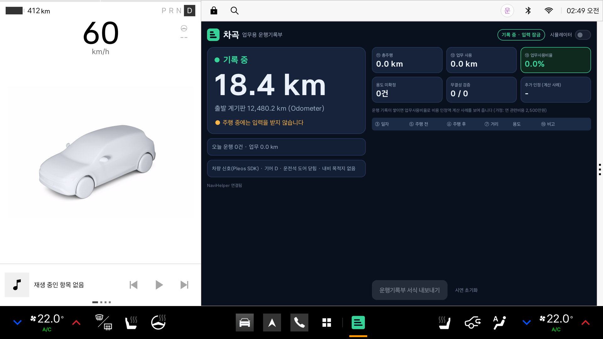
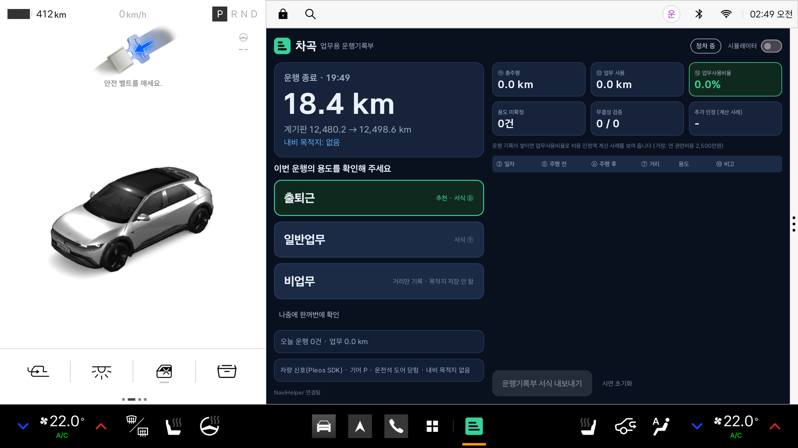
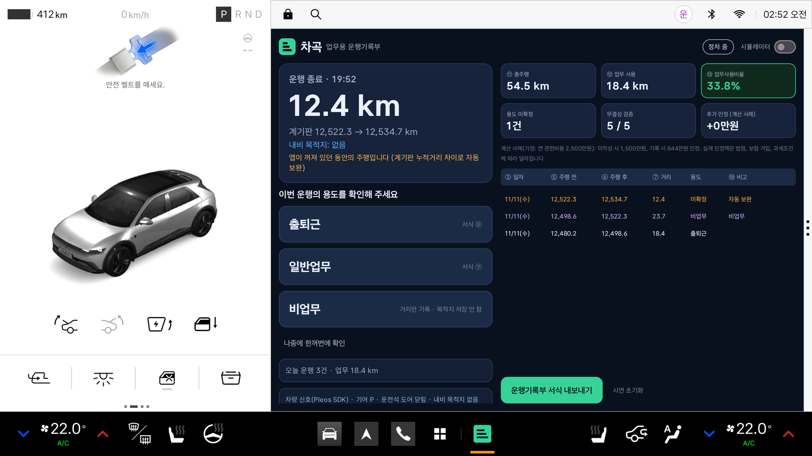
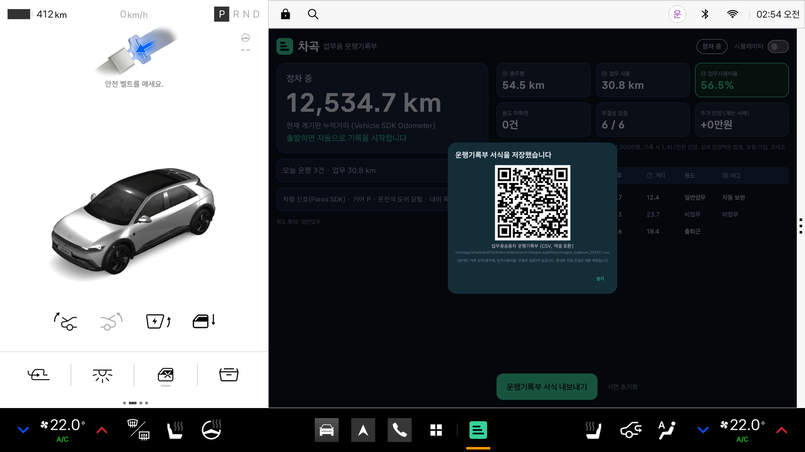
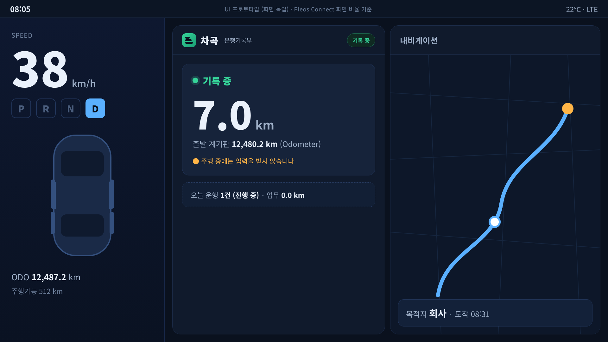
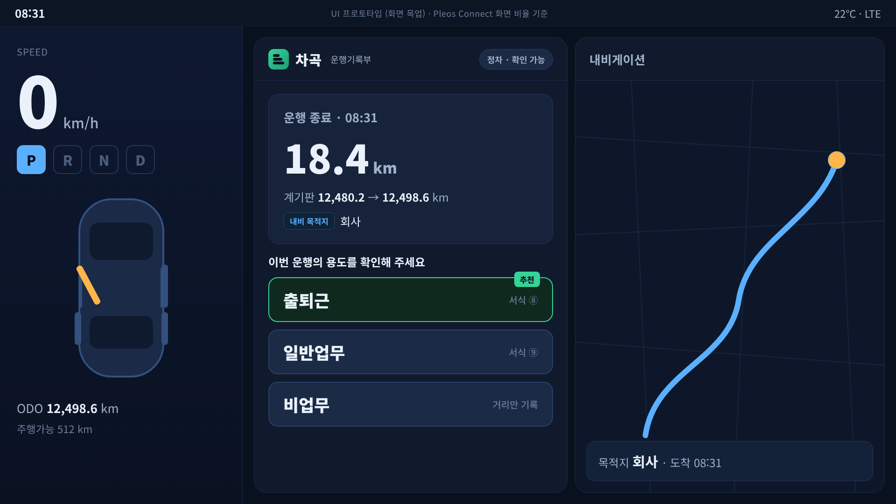
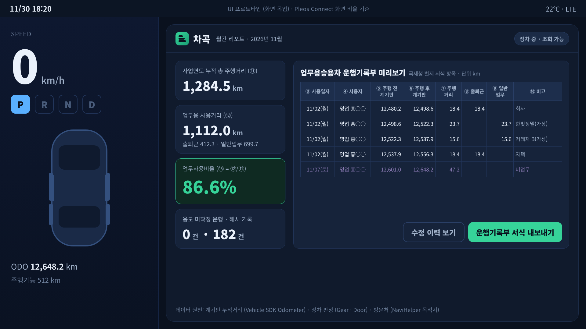
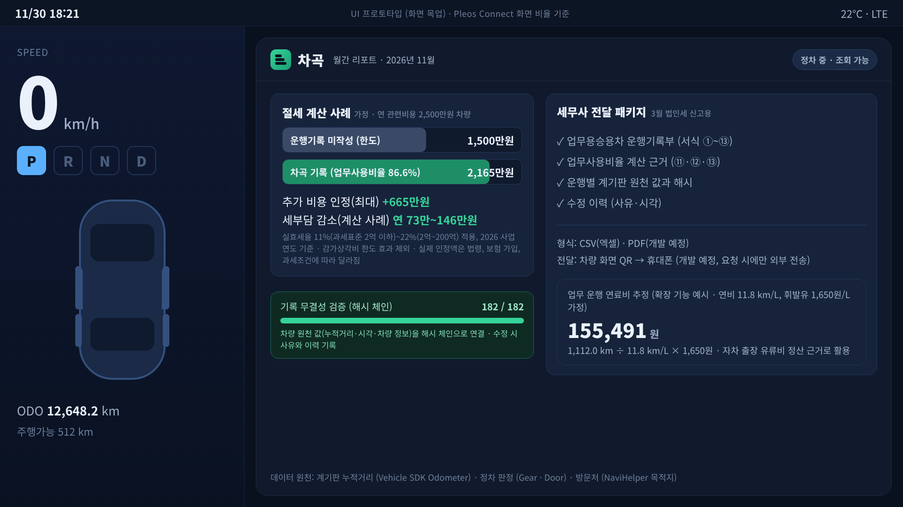

# 차곡 (Chagok)

**운전만 하세요. 운행기록부는 차가 차곡차곡 씁니다.**

Pleos Connect 차량에서 계기판 누적거리(Vehicle SDK Odometer), 기어·도어 신호(Gear, Door), 내비게이션 목적지(NaviHelper SDK)를 직접 읽어, 운전자가 입력하지 않아도 「업무용승용차 운행기록부」 서식에 맞춰 운행 기록을 자동으로 작성하고 내보내는 업무(Business) 앱입니다.

| 주행 중: 누적거리로 자동 기록, 입력 잠금 | 기어 P: 용도 확인 카드, 1탭 확정 |
|---|---|
|  |  |
| **앱이 꺼져 있던 구간 자동 보완** | **리포트와 서식(CSV) 내보내기** |
|  |  |

> 위 4장은 이 저장소의 `apk/개인참가_차곡_release.apk` 를 **Pleos Connect Emulator 2.1.0** 에 설치하고, Virtual Console 로 누적거리·기어·도어 신호를 바꿔 가며 캡처한 실제 실행 화면입니다. 같은 과정을 `scripts/ci/pleos_run.sh` 로 다시 실행할 수 있습니다.

---

## 1. 앱 이름과 한 줄 소개

- **앱 이름**: 차곡 (Chagok)
- **한 줄 소개**: 계기판 누적거리와 기어·도어·내비 신호를 차량에서 직접 읽어 「업무용승용차 운행기록부」 서식에 맞춰 운행 기록을 자동으로 작성하고 내보내는 Pleos Connect 업무 앱

## 2. 실행 방법

### A. APK 설치 (가장 빠른 방법)
```bash
adb install -r "apk/개인참가_차곡_release.apk"
adb shell am start -n com.chagok.app/.MainActivity
```

### B. 소스 빌드
```bash
./gradlew assembleRelease      # 제출용 release APK (디버그 키로 서명되어 바로 설치 가능)
./gradlew testDebugUnitTest    # 단위 테스트 20개
adb install -r app/build/outputs/apk/release/app-release.apk
```
Android Studio(최신 버전, JDK 17)에서 저장소를 열어 `app` 을 실행해도 됩니다. Pleos SDK 저장소(`https://nexus-playground.pleos.ai/repository/maven-releases/`)는 `settings.gradle.kts` 에 등록되어 있습니다.

### C. Pleos Connect 에뮬레이터에서 시연 (차량 신호 사용)
1. Pleos Connect 에뮬레이터를 켜고 앱을 실행합니다. 화면에 `현재 계기판 누적거리 (Vehicle SDK Odometer)` 와 `차량 신호(Pleos SDK) · 기어 P · 운전석 도어 닫힘` 이 표시됩니다.
2. `adb forward tcp:8088 tcp:8088` 후 브라우저에서 Virtual Console(`http://127.0.0.1:8088/`)을 엽니다.
3. 기어를 **D** 로 바꾸고 **Emulation Controls > Odometer** 값을 올립니다. 0.1 km 이상 늘면 앱이 `기록 중` 으로 바뀌고 입력이 잠깁니다.
4. 기어를 **P** 로 바꾸면 용도 확인 카드가 바로 뜹니다. 추천 버튼을 한 번 누릅니다. 60초 동안 움직이지 않으면 운행이 확정됩니다(그 사이 다시 출발하면 같은 운행으로 이어 기록).
5. 앱을 종료한 상태에서 Odometer 값을 올린 뒤 다시 실행하면, 누락된 구간이 `용도 확인 필요` 운행으로 채워집니다.
6. `운행기록부 서식 내보내기` 를 누르면 CSV 파일이 저장됩니다.

같은 흐름을 명령으로 실행하는 스크립트: `scripts/ci/pleos_drive.py` (Virtual Console 의 HTTP 주소를 호출).

### D. 차량 신호가 없는 기기에서 시연 (앱 내 시뮬레이터)
일반 Android 기기·에뮬레이터에서는 5초 뒤 `차량 신호 없음 · 시뮬레이터로 시연하기` 버튼이 나타납니다. 누른 뒤 `다음 운행 재생` 으로 같은 흐름을 재현합니다. 시뮬레이터 기록은 화면과 CSV 에 시뮬레이터 값임이 표시됩니다.

## 3. 테스트 환경과 필요한 설정

| 항목 | 값 |
|---|---|
| 빌드 | AGP 8.8.2, Kotlin 2.0.0, Gradle 8.10.2, JDK 17, compileSdk/targetSdk 35, minSdk 33 |
| SDK | Vehicle SDK `ai.pleos.playground:Vehicle:2.3.2`, NaviHelper SDK `ai.pleos.playground:NaviHelper:3.0.5` |
| 퍼미션 | `pleos.car.permission.CAR_DRIVE`, `CAR_MILEAGE`, `CAR_DOORS`, `NAVI_ROUTE`, `NAVI_ROUTE_SEARCH` (모두 조회용) |
| Pleos Playground | Vehicle·NaviHelper SDK 는 별도 신청 없이 사용 가능한 범위만 사용. 이 에뮬레이터 버전에서는 CRN 주입 없이 실행됨 |
| 자동 확인 | GitHub Actions: `build-apk.yml`(단위 테스트·release 빌드), `pleos.yml`(Pleos Connect 에뮬레이터), `smoke.yml`(일반 Android 14 에뮬레이터) |

## 4. 개발에 사용한 Pleos Connect 에뮬레이터 버전과 화면 규격

| 항목 | 값 |
|---|---|
| 에뮬레이터 | **Pleos Connect Emulator 2.1.0** (시스템 이미지 `Pleos Connect v2.1.0 APIs`, 빌드 `RELEASE.release_connect_v2.1.0`, Android 14 / API 34, x86_64) |
| 설치 경로 | 공식 SDK Update Site `https://nexus-playground.pleos.ai/repository/raw-releases/connect-avd/2.x/crp-sys-img.xml` |
| 화면 규격 | **2560 x 1440 px, 160 dpi, 12.8형, 가로** (기기 정의 `Pleos Connect v2.1.0`) |
| 앱 창 크기 | 1682 x 1210 px (화면 오른쪽 앱 영역, 창 1개 실행 기준) |
| 화면 대응 | 태블릿 가로(1280 x 740 dp) 기준으로 설계하고, 앱 창 크기에 맞춰 화면 전체를 비례 확대(이 에뮬레이터에서 약 1.31배). 좁은 창에서는 세로형 배치로 전환 |
| AVD 설정 | RAM 4GB, Cold boot. 자동 확인(GitHub Actions)에서는 소프트웨어 렌더링 사용 |
| 차량 신호 조작 | Virtual Console (`adb forward tcp:8088 tcp:8088` → `http://127.0.0.1:8088/`) |

## 5. APK 위치

- `apk/개인참가_차곡_release.apk` (release 빌드, 설치 가능한 서명 포함, GitHub Actions 가 소스에서 빌드해 올림)
- 파일명은 `팀명_앱이름_release.apk` 규칙을 따랐습니다. 개인 참가이고 저장소에 실명을 적지 않기 위해 팀명 자리에 `개인참가` 를 적었습니다.
- 용량 한도를 넘으면 GitHub Releases 에 등록하고 이 항목에 Release 주소를 적습니다.

---

## 현재 구현 상태 (2026.11.11)

| 구분 | 내용 | 확인 방법 |
|---|---|---|
| Pleos Connect 에뮬레이터에서 확인 | Vehicle SDK 로 누적거리·기어·운전석 도어 수신, 누적거리 증가로 운행 시작, 기어 P 에서 용도 확인 카드, 1탭 확정, 60초 정지 후 확정, 앱 미실행 구간 자동 보완, 리포트(서식 ⑪⑫⑬), CSV 내보내기, 화면 비례 확대 | `scripts/ci/pleos_run.sh` (Pleos Connect Emulator 2.1.0 + Virtual Console) |
| 로직 단위 테스트 | 운행 판정 상태 기계(기어 P·도어·재출발·늦게 도착한 값), 누락 구간 보완, 해시 체인 원장, 서식 계산·CSV, 용도 추천, 화면 배율 | 단위 테스트 20개 통과 (`./gradlew testDebugUnitTest`) |
| 연결만 확인 | NaviHelper SDK 초기화(`NaviHelper 연결됨`). 목적지·도착 이벤트는 내비 앱에서 경로를 설정한 상태의 실측이 남아 있음. 목적지에 따른 용도 추천과 비업무 목적지 미저장은 앱 내 시뮬레이터로 확인 | `scripts/ci/smoke.sh` |
| 개발 예정 | 차종·등록번호·사용자 입력 화면, QR 파일 전달, PDF 출력, 포그라운드 서비스 상시 기록, 확정 후 수정 화면, 계기판 값 수동 보정, Fleet 관리자 웹, 음성 확인(TTS·STT·Gleo AI), 연료·전기 비용 추정(Fuel·EvBattery) | 1차 결과 후~2차 PT |

절세 효과 수치(예: 추가 인정 최대 665만원)는 가정에 따른 계산 사례이며, 실제 인정 금액은 관련 법령, 업무전용자동차보험 가입, 감가상각비 한도, 개별 과세조건에 따라 달라집니다.

## 동작 원리

```
Vehicle SDK Odometer ──┐
Vehicle SDK Gear ──────┤
Vehicle SDK Door ──────┼─> TripDetector (상태 기계) ─> 원장(해시 체인) ─> 1탭 용도 확정 ─> 서식 CSV
NaviHelper 목적지/도착 ─┘        IDLE ⇄ DRIVING
```

- **운행 시작**: 누적거리가 기준점 대비 0.1 km 이상 증가
- **운행 종료**: 기어를 P 에 두거나 운전석 도어가 열리면 용도 카드를 바로 띄우고, 60초 동안 움직이지 않을 때 운행을 확정. 그 사이 다시 출발하면 같은 운행으로 이어감. 내비 도착 후 2분 정지, 장시간 10분 정지도 종료로 판정. 기어·도어 신호가 없는 차량에서도 누적거리와 정지 시간만으로 동작
- **늦게 도착한 값 처리**: 기어 P 뒤에 들어온 누적거리 값은 재출발로 보지 않고 운행 끝 값(서식 ⑥)에만 반영. 직전 값보다 작은 누적거리 값은 버리고, 이미 기록된 구간과 겹치는 구간은 새 운행으로 만들지 않음
- **누락 구간 보완**: 앱이 꺼져 있던 동안 달린 거리는 마지막 운행의 ⑥과 현재 계기판 값의 차이로 찾아 `용도 확인 필요` 운행으로 채움(0.1 km 미만 무시, 값이 줄거나 2,000 km 넘게 바뀌면 자동 보완 대신 확인 요청)
- **용도 추천**: 주말 → 비업무, 목적지가 회사·집 → 출퇴근, 그 밖의 목적지 → 일반업무, 목적지 없음 → 시간대 규칙
- **수정 이력 추적·무결성 검증**: 차량 원천 값(누적거리·시각)을 revision 0 으로 기록하고, 용도 확정·수정은 새 revision 으로 쌓습니다. 한 줄만 고쳐도 이후 해시 검증이 실패합니다. 로컬 해시 체인은 사후 수정을 드러내는 장치이며 모든 조작을 막는다고 보장하지는 않습니다.
- **사생활 보호**: 비업무로 확정하면 목적지를 저장하지 않습니다. 기록은 차량 내 파일에 저장하고, 내보내기를 요청할 때만 밖으로 보냅니다. 차대번호(VIN) 등 차량 식별 정보는 읽지 않습니다.
- **주행 안전**: 앱 자체 '주행 중' 판정과 AAOS `CarUxRestrictions` 를 함께 써서 주행 중 입력을 막습니다.

## 코드 구조

| 경로 | 역할 |
|---|---|
| `vehicle/PleosVehicleSignals.kt` | Vehicle SDK 연동 (Odometer, Gear, Door) + NaviHelper 시작 |
| `navi/NaviSignals.kt` | NaviHelper SDK 연동 (목적지 조회, 도착 이벤트) |
| `vehicle/SimulatedVehicleSignals.kt` | 차량 신호가 없는 기기에서 시연하는 시뮬레이터 (같은 인터페이스) |
| `engine/TripDetector.kt` | 운행 판정 상태 기계 |
| `engine/ContinuityChecker.kt` | 계기판 누적거리 연속성 검사(앱 미실행 구간 보완, 기록 구간 겹침 방지) |
| `engine/OdometerFilter.kt` | 직전 값보다 작게 들어온 누적거리 값 걸러내기 |
| `engine/PurposeAdvisor.kt` | 용도 추천 규칙 |
| `engine/LogbookCalculator.kt` | 서식 ⑪⑫⑬, 비용 인정 계산 사례 |
| `engine/DisplayScale.kt` | 차량 디스플레이 크기에 맞춘 화면 배율 |
| `data/HashChain.kt`, `data/TripStore.kt` | 해시 체인 무결성 검증, 추가 전용 원장 |
| `export/NtsLogbookExporter.kt` | 업무용승용차 운행기록부 별지 서식 항목 순서의 CSV (UTF-8 BOM) |
| `ux/UxRestrictionWatcher.kt` | 주행 규제 상태 수신 |
| `ui/ChagokScreen.kt` | 가로(상태+리포트) / 세로(상태·1탭) 화면 |
| `scripts/ci/` | 에뮬레이터 자동 확인 스크립트 (`pleos_setup.sh`, `pleos_run.sh`, `pleos_drive.py`, `smoke.sh`) |

## 화면 콘셉트 (UI 프로토타입)

차량 계기판·내비게이션과 함께 놓였을 때의 화면 구상입니다. 실제 앱 화면이 아니라 화면 목업입니다.

| 주행 중 | 도착 직후 |
|---|---|
|  |  |
| **월간 리포트** | **절세 계산 사례·무결성 검증** |
|  |  |

## 참고

- Pleos Playground 문서: Vehicle SDK, NaviHelper SDK, 개발 환경 구성(에뮬레이터), Virtual Console
- 공식 샘플: `Pleos-Playground/pleos-sample-vehicle-app`, `Pleos-Playground/pleos-sample-navi-app` (빌드 구성과 SDK 호출 방식 참고)
- 법령: 법인세법 시행령 제50조의2, 법인세법 시행규칙 별지 서식 「업무용승용차 운행기록부」
